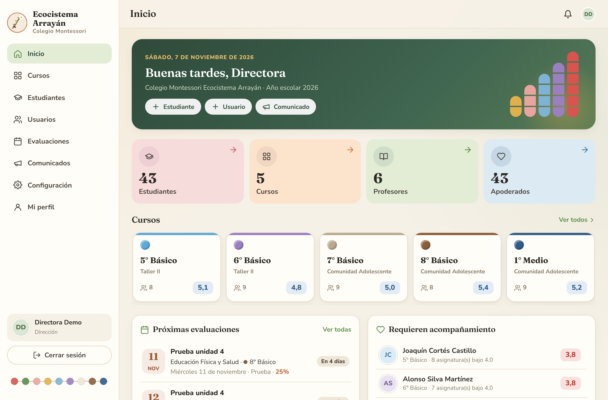
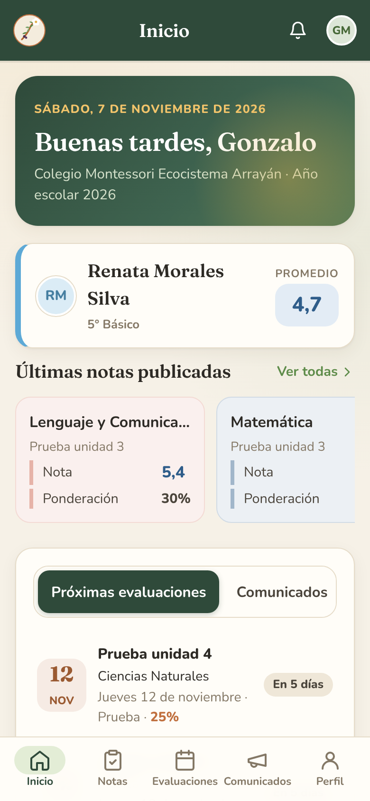
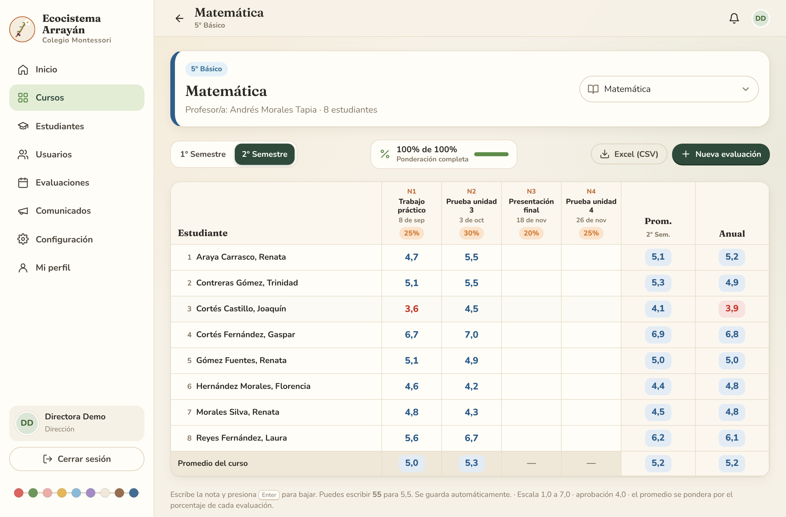
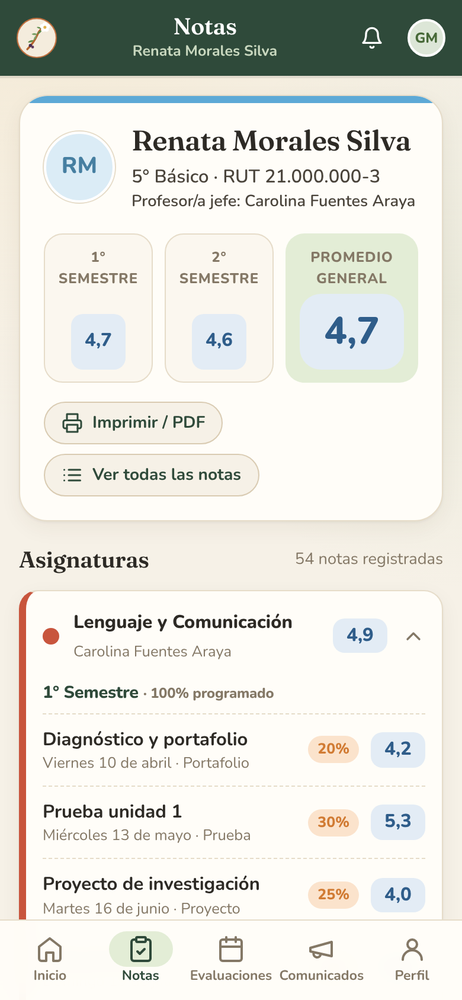

# 🌳 Ecocistema Arrayán — Plataforma de notas

Aplicación web **y app instalable en el celular** para el **Colegio Montessori Ecocistema Arrayán**.
Permite registrar notas con **porcentaje (ponderación)** para **5° Básico, 6° Básico, 7° Básico, 8° Básico y 1° Medio**,
con tres tipos de acceso por **RUT + clave**:

| Rol | Qué puede hacer |
|---|---|
| **Dirección (dueña)** | Acceso total: crea y edita cursos, asignaturas, estudiantes, profesores y apoderados; edita **todas** las notas; restablece claves; configura la escala; descarga respaldos y ve el historial de cada cambio. |
| **Profesor/a** | Ve sus cursos; crea evaluaciones con su porcentaje y pone notas **solo en sus asignaturas**; publica comunicados a sus cursos. El profesor/a jefe puede ver todas las notas de su curso. |
| **Apoderado/a** | Ve las notas, porcentajes y promedios **solo de sus pupilos**, las próximas evaluaciones y los comunicados. Puede imprimir el informe de notas. |

<p align="center">
  
  
</p>
<p align="center">
  
  
</p>

## ✨ Funciones

- **Libro de notas editable** tipo planilla: cada evaluación tiene nombre, fecha, tipo y **porcentaje**. Se escribe la nota y se guarda sola (escribe `55` y queda 5,5). Muestra si la suma de porcentajes del período llega a 100%.
- **Promedios automáticos**: promedio ponderado por período (semestre o trimestre), promedio anual y promedio general. Escala 1,0–7,0 con aprobación 4,0 (configurable). Notas en **azul** (aprobadas) y **rojo** (bajo 4,0).
- **Resumen de notas del curso** (estudiantes × asignaturas) y **exportación a Excel (CSV)**.
- **Informe de calificaciones** imprimible / PDF, con logo, firmas y detalle de cada evaluación.
- **Evaluaciones ocultas**: el profesor puede ingresar notas y publicarlas a los apoderados cuando quiera.
- **Estudiantes por curso**, con carga rápida pegando una lista desde Excel o Google Sheets.
- **Apoderados vinculados** a uno o varios pupilos; al crearlos se genera una **clave temporal** que deben cambiar al primer ingreso.
- **Comunicados** para todo el colegio o un curso, y **próximas evaluaciones** en calendario.
- **Panel de dirección**: totales, promedios por curso, estudiantes que **requieren acompañamiento** y actividad reciente.
- **Historial (auditoría)**: queda registrado quién ingresó o cambió cada nota y cuándo.
- **Respaldo y restauración** completos en un archivo.
- Validación de **RUT chileno** (dígito verificador).
- Diseño **Montessori**: madera, lino, verde bosque y la corteza canela del arrayán; cada curso lleva el color de su perla en la **escalera de perlas** (5 celeste, 6 lila, 7 perla, 8 café, 9 = 1° Medio azul). Ilustraciones de la torre rosa, las barras numéricas y las perlas doradas.
- **App instalable** (PWA) en Android, iPhone y computador, sin pasar por tiendas de aplicaciones.
- Seguridad: claves cifradas (scrypt), sesiones seguras, límite de intentos de ingreso, protección CSRF y permisos verificados en el servidor.

## 🚀 Probarla en tu computador

Necesitas **Node.js 22.13 o superior** (https://nodejs.org). No hay que instalar nada más.

```bash
npm start
```

Abre http://localhost:3000. La primera vez se te pedirá **crear la cuenta de dirección** (tu RUT y tu clave).

### Con datos de demostración

```bash
npm run demo -- --force   # ⚠ borra la base local y crea una demo
npm start
```

Todas las cuentas de la demo usan la clave `arrayan2026`:
- Dirección: RUT **11.111.111-1**
- Profesor/a: RUT **12.000.000-4**
- Apoderado/a: RUT **15.000.000-9**

## 🌐 Publicarla en internet

La aplicación es un solo servidor Node.js sin dependencias externas y guarda todo en un archivo SQLite
(`DATA_DIR/arrayan.db`). **Debe tener un disco permanente** para no perder las notas.

### Opción A — Render.com (recomendada, la más simple)
1. Crea una cuenta en https://render.com e inicia sesión con GitHub.
2. **New → Blueprint** y elige este repositorio. Render leerá `render.yaml` y creará el servicio con un disco de 1 GB.
3. Al terminar tendrás una dirección como `https://ecocistema-arrayan.onrender.com`. Ábrela y crea la cuenta de dirección.
4. (Opcional) En *Settings → Custom Domains* puedes usar un dominio propio, por ejemplo `notas.ecocistemaarrayan.cl`.

> El plan con disco permanente es de pago (aprox. USD 7/mes). Los planes gratuitos **borran los datos** al reiniciar.

### Opción B — Docker (Railway, Fly.io, un VPS, etc.)
```bash
docker build -t arrayan .
docker run -d -p 3000:3000 -v arrayan-datos:/data --restart unless-stopped arrayan
```
Monta siempre un volumen en `/data`. Pon un proxy HTTPS delante (Caddy, Nginx o el del proveedor).

### Variables de entorno
| Variable | Por defecto | Descripción |
|---|---|---|
| `PORT` | `3000` | Puerto del servidor |
| `DATA_DIR` | `./data` | Carpeta donde se guarda la base de datos |
| `COOKIE_SECURE` | — | `1` para forzar cookies seguras (se activa solo si el proxy envía `X-Forwarded-Proto: https`) |
| `TRUST_PROXY` | `1` | `0` si el servidor está expuesto directamente sin proxy |

## 📱 Instalar la app en el celular
- **Android (Chrome):** abre la página → menú ⋮ → *Instalar aplicación*.
- **iPhone (Safari):** botón Compartir → *Agregar a pantalla de inicio*.

## 🧭 Primeros pasos como dirección
1. **Configuración → Colegio**: revisa nombre, año escolar, dirección y teléfono.
2. **Usuarios → Nuevo usuario**: crea a los profesores (se genera una clave temporal para entregarles).
3. **Cursos → (curso) → Asignaturas → ✏️**: asigna el profesor/a de cada asignatura y el profesor/a jefe.
4. **Cursos → (curso) → Estudiantes → Pegar lista**: carga a los estudiantes desde Excel.
5. Edita cada estudiante para **vincular a su apoderado** (se crea su acceso con clave temporal).
6. Los profesores crean sus evaluaciones con porcentaje y ponen las notas.
7. **Configuración → Respaldos**: descarga un respaldo cada semana.

## 🗂 Estructura
```
server.js              servidor HTTP (API + archivos)
src/db.js              base de datos y valores iniciales (cursos y asignaturas)
src/api.js             rutas de la API y permisos por rol
src/auth.js            claves, sesiones, límite de intentos
src/grades.js          promedios ponderados
src/rut.js             validación de RUT
public/                aplicación web (HTML, CSS, JS sin compilar) + PWA
scripts/demo.js        datos de demostración
test/                  pruebas automáticas (npm test)
```

## ✅ Pruebas
```bash
npm test
```
